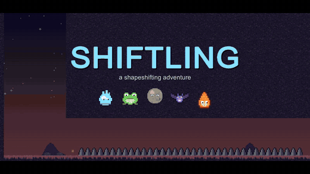

# SHIFTLING

*A shapeshifting adventure: become creatures and objects, and take on their abilities and their weaknesses.*

Made for **[GitHub Game Off 2026](https://itch.io/jam/game-off-2026)**. The theme is **SHIFT**.

## Trailer

[](Trailer/Shiftling-Trailer.mp4)

▶ **[Watch the full trailer (59 s, with sound)](Trailer/Shiftling-Trailer.mp4)**

## Download

**[⬇ Download for Windows (latest release)](https://github.com/Agneay-Community-Hub/SHIFTLING/releases/latest)**: unzip the file and run `Shiftling.exe`.

You are a Wisp, a small spirit that can copy any shape it touches at an old shrine. Each shape solves one problem and brings a new danger. A Boulder walks over spikes but sinks in water. An Ember swims through lava but goes out in a puddle. You get through the levels by changing shape at the right moment. The key that does the swap is **SHIFT**.

## The shapes

| # | Shape | Ability | Weakness |
|---|-------|---------|----------|
| 1 | **Wisp** | Double jump | Dies in water, on spikes and in lava |
| 2 | **Frog** | Big jump, swims in water | Dries out on land, then turns back into a Wisp |
| 3 | **Boulder** | Safe on spikes, breaks cracked floors, pushes crates, heavy enough for pressure plates | Can't jump, sinks in water, big and slow |
| 4 | **Bat** | Flies while you hold Jump | Gets tired fast, fans blow it away, can't touch water |
| 5 | **Ember** | Swims in lava, burns wooden barriers, fast | Water puts it out |

You learn each shape at its shrine. After that you can switch to it at any time, as long as there is room for its size.

## Controls

| Action | Keyboard | Gamepad |
|--------|----------|---------|
| Move | A / D or ← / → | Left stick / D-pad |
| Jump / fly / swim up | Space, W, ↑ or Z | South button (A) |
| Swim down | S / ↓ | Stick down |
| Shift to a shape | 1 – 5 | – |
| Previous / next shape | Q / E | LB / RB |
| Swap back to your last shape | **Shift** or Tab | West button (X) |
| Restart level | R | Select |
| Pause | Esc / P | Start |
| Mute | M | – |

## Levels

1. **Awakening**: moving, the double jump, and the Frog
2. **Heavy Heart**: the Boulder, cracked floors, a crate, a pressure plate and a door
3. **Night Wings**: the Bat, flying until it tires, and fans that throw it into spikes
4. **Ember Road**: the Ember swimming through lava, burning barriers, then switching to the Frog for water
5. **The Grand Shift**: every shape in one level

## Tech

* **Unity 6000.4.3f1** with URP 2D and the Input System. The project was created and built with the **Unity CLI**.
* **There are no imported art or audio files.** All sprites are painted in code (`Art.cs`), and all sound effects and the music loop are synthesized when the game starts (`Sfx.cs`).
* The game builds itself at runtime. `Game.cs` boots from `RuntimeInitializeOnLoadMethod`, so the scene only needs a camera.
* Levels are ASCII maps generated by `Tools/levelgen.py` into `Assets/Scripts/LevelData.cs`.

```
Assets/Scripts/
  Game.cs      game states, camera, parallax background, HUD (IMGUI)
  Player.cs    controller, shifting, and each shape's abilities and weaknesses
  Level.cs     tiles, colliders, crates, plates/doors, crumbling, burning, wind
  Forms.cs     shape definitions
  Art.cs       procedural pixel art
  Sfx.cs       procedural audio
  Fx.cs        pooled particles
  Controls.cs  keyboard and gamepad input
Assets/Editor/BuildScript.cs   command-line builds
Tools/levelgen.py              level source to regenerate LevelData.cs
```

## Building from the command line

```bash
# WebGL (upload the contents of Builds/WebGL to itch.io as an HTML5 game)
unity build --target WebGL --execute-method BuildScript.BuildWebGL --output-path Builds/WebGL --allow-dirty-build

# Windows
unity build --target StandaloneWindows64 --execute-method BuildScript.BuildWindows --output-path Builds/Windows/Shiftling.exe --allow-dirty-build

# Regenerate levels after editing Tools/levelgen.py
python Tools/levelgen.py
```

## Tests

`Assets/Tests/MechanicsTests.cs` holds 16 PlayMode tests. They play the real game with simulated input and check jump heights, the Frog's underwater route, the Boulder breaking the cracked floor and pushing the crate onto the plate to open the door, the Bat's flight, the wind shaft lifting a Wisp and killing a Bat, the Ember crossing lava, and the room check before a shift. They also play the final shaft of level 5.

```bash
unity test --mode PlayMode --output Logs/test-results.xml
```

## Recording the trailer

`Trailer/Shiftling-Trailer.mp4` is a 59-second 1280×720 trailer, recorded from the real game. Running the player with `-trailer <dir>` (see `Assets/Scripts/Trailer.cs`) plays scripted shots with simulated input. It writes every frame at a locked 30 fps and rebuilds the soundtrack (music plus every sound effect, in sync) as a WAV file. To re-record it:

```bash
powershell -ExecutionPolicy Bypass -File Tools/make_trailer.ps1
```

The script needs ffmpeg on your PATH.

## Submitting to Game Off

1. Push this folder to a **public** GitHub repository. The `.gitignore` already leaves out `Library/`, `Builds/` and `Logs/`.
2. Build WebGL (see above). Zip the **contents** of `Builds/WebGL`, so that `index.html` is at the root of the zip.
3. On itch.io, create a new project with Kind = **HTML** and upload the zip with "This file will be played in the browser" checked. Set the viewport to **1280 × 720** and turn on the fullscreen button.
4. Submit the itch page to the jam at https://itch.io/jam/game-off-2026 and link the GitHub repo. The deadline is **December 1, 2026, 13:37 PST**.

## Editing levels

Open `Tools/levelgen.py`. Levels are built with `rect(x0, x1, row0, row1, char)` and `put(x, row, char)`.
Legend: `#` ground, `S` spikes, `W` water, `L` lava, `C` cracked floor, `B` wooden barrier, `X` crate, `P` pressure plate, `D` door, `F` fan, `K` checkpoint, `O` exit, `@` start, and `f b v e` for the shrines (Frog, Boulder, Bat, Ember).

## License

The code is released under the MIT License (see `LICENSE`).
